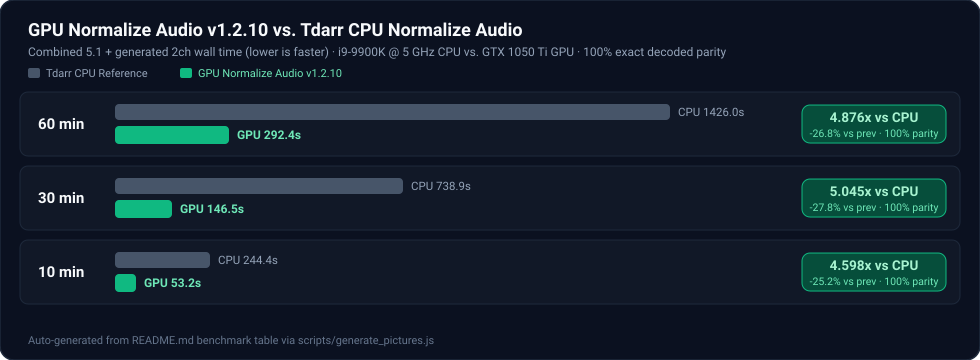
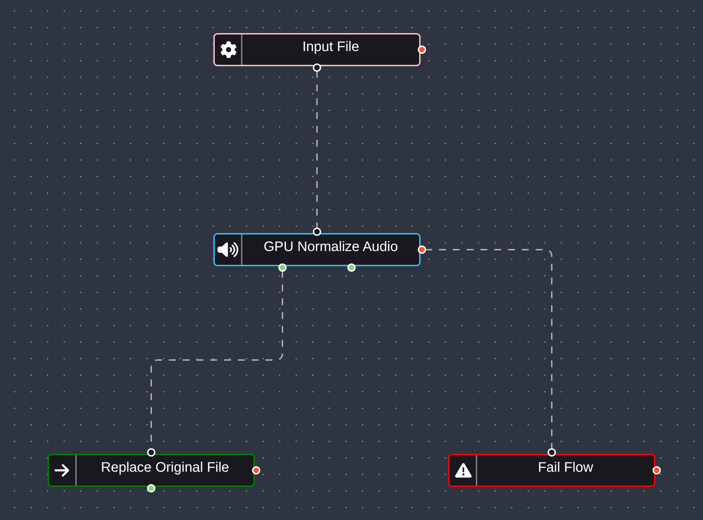
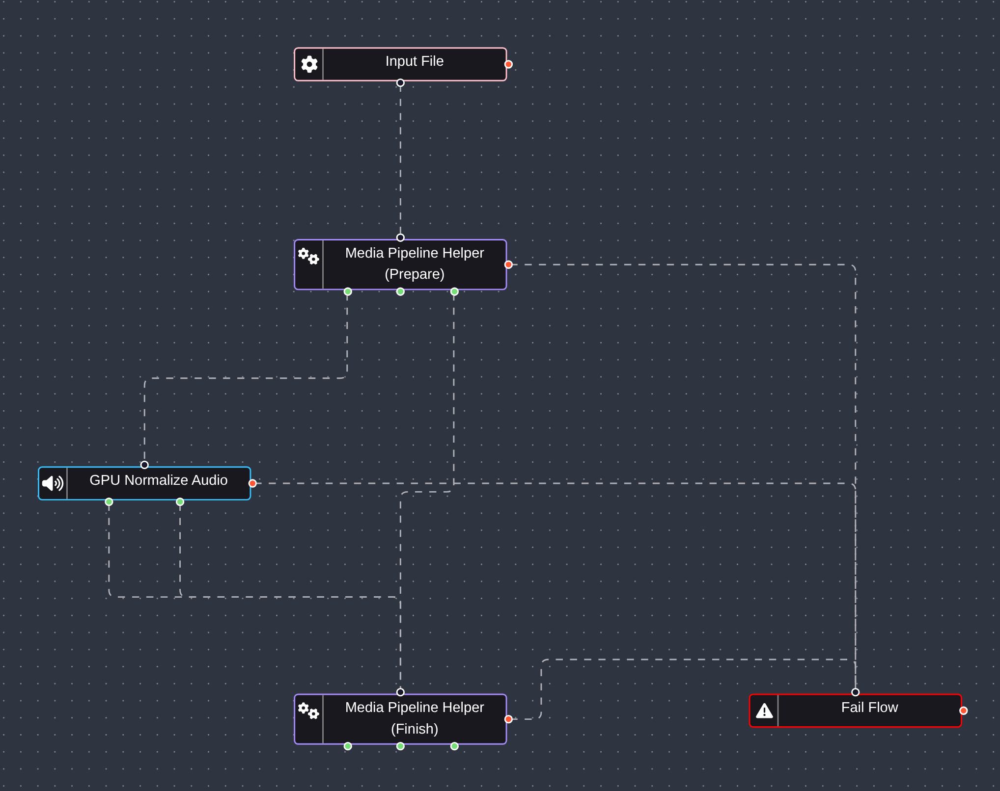
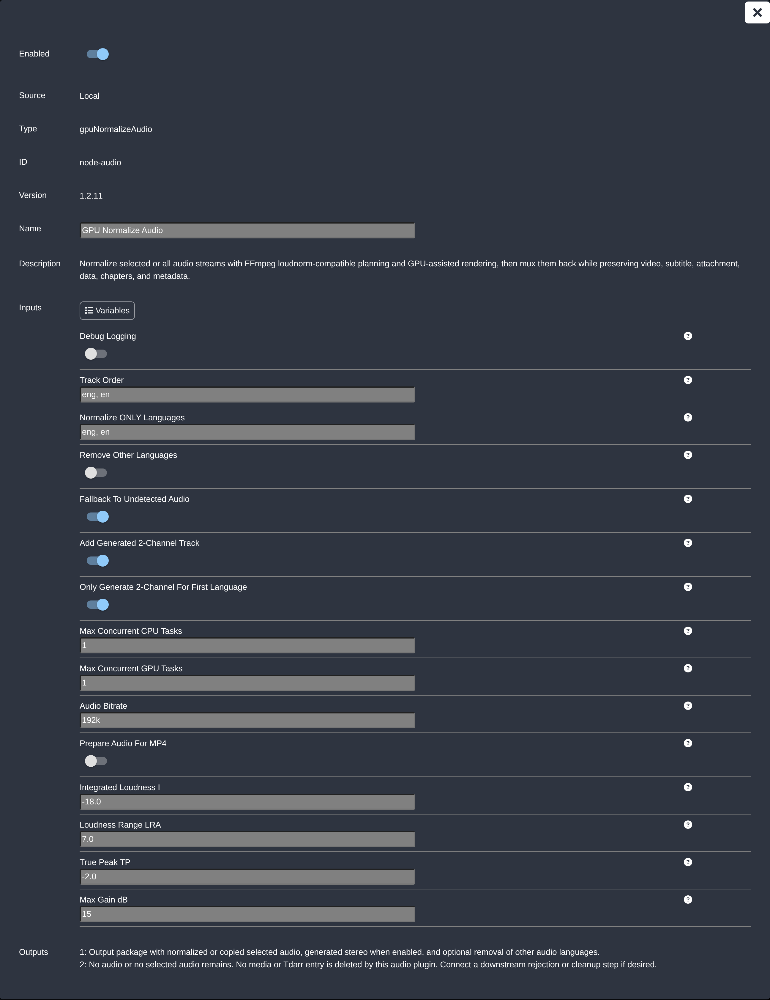
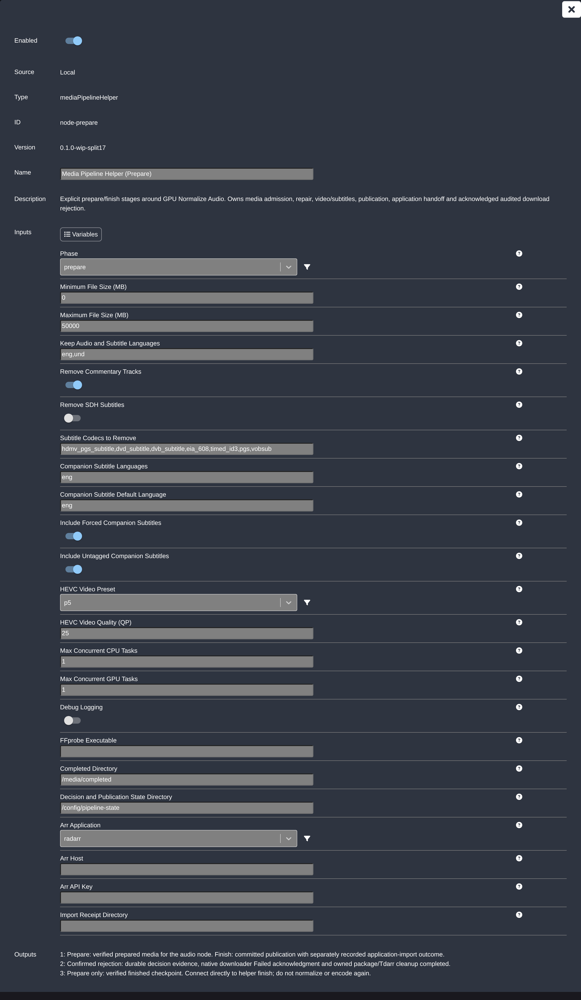
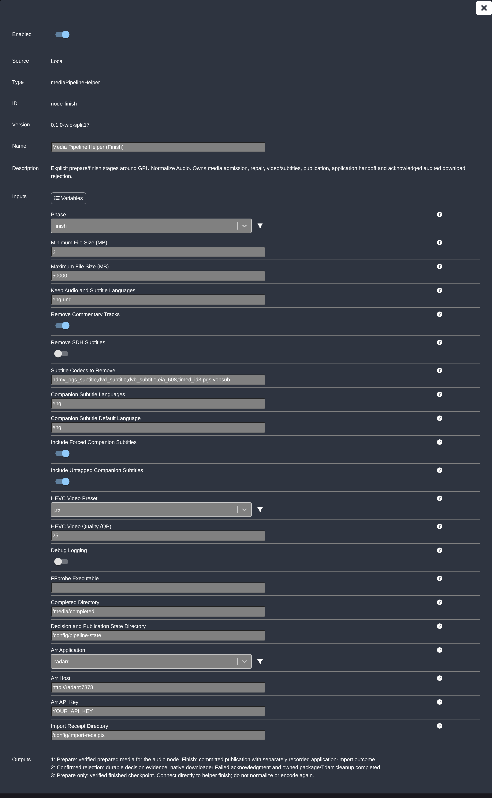

# GPU Normalize Audio for Tdarr

[](release-notes/1.2.9.md)
[](#performance)
[](#performance)

> [!WARNING]
> **USE AT YOUR OWN RISK · WIP** — *It might burn your house ;-)*

A Tdarr FlowPlugin that moves FFmpeg `loudnorm`-style audio normalization onto CUDA GPUs while matching Tdarr's CPU-only `Normalize Audio` output **sample-for-sample (`100%` decoded parity)** — plus an optional companion **Media Pipeline Helper** (`prepare` / `finish`) for full 3-node media integrity, HEVC encoding, subtitle handling, and Radarr/Sonarr publication.

- **Exact CPU parity first:** Verified against Tdarr CPU `Normalize Audio` (`energy_similarity=1.000000000`, `rms_diff=0`) across long 5.1 + generated stereo jobs and codec smokes (AAC, MP3, AC3, E-AC-3, DTS, multi-audio).
- **Fast on long media:** `4.5x`–`5.3x` faster than CPU (`24%`–`34%` faster than `1.2.8`) using streaming two-pass `gpuSourcePort` — no giant raw PCM temp files.
- **Full stream preservation:** Normalizes selected audio streams (or all streams) while preserving video, subtitles, chapters, metadata, attachments, data streams, and zero-tolerance ISO MP4/MOV timing clocks.
- **Standalone or 3-node pipeline:** Run **GPU Normalize Audio** on its own in any Tdarr Flow, or wrap it with **Media Pipeline Helper** (`prepare` → `GPU Normalize Audio` → `finish`) for admission, cleanup, HEVC video, original-relative integrity verification, and Arr handoff.

---

## Performance

Tested on **i9-9900K @ 5 GHz (CPU reference)** vs. **NVIDIA GTX 1050 Ti (GPU `1.2.9`)** using a 5.1 source with no existing stereo track (combined workload = normalized original 5.1 + generated normalized 2-channel fallback, both verified against Tdarr CPU `Normalize Audio`).

`Speed vs CPU` is measured `SRC_CPU / GPU` wall time: above `1.0x` is faster than CPU, below `1.0x` is slower. Short smoke clips are used for parity checks only and are excluded here.



| Length | CPU Reference | GPU `1.2.9` | Speed vs CPU | vs `1.2.8` | Result |
| --- | ---: | ---: | ---: | ---: | --- |
| **90 min** | `2193.2s` | **`416.9s`** | **`5.260x`** | `-34.1%` | 426% faster · 5.1 & +2ch parity passed |
| **60 min** | `1374.8s` | **`303.5s`** | **`4.529x`** | `-24.0%` | 353% faster · 5.1 & +2ch parity passed |
| **30 min** | `688.7s` | **`139.4s`** | **`4.940x`** | `-31.3%` | 394% faster · 5.1 & +2ch parity passed |
| **10 min** | `262.8s` | **`51.5s`** | **`5.104x`** | `-27.6%` | 410% faster · 5.1 & +2ch parity passed |

<details>
<summary>Per-stream breakdown (Original 5.1 vs. Generated 2ch)</summary>

| Length | Stream | CPU Reference | GPU `1.2.9` | Speed vs CPU | Result |
| --- | --- | ---: | ---: | ---: | --- |
| 90 min | Original 5.1 | `1744.5s` | `320.2s` | `5.449x` | 445% faster · 5.1 parity passed |
| 90 min | Generated 2ch | `448.7s` | `342.6s` | `1.310x` | 31% faster · +2ch parity passed |
| 60 min | Original 5.1 | `1083.0s` | `252.9s` | `4.282x` | 328% faster · 5.1 parity passed |
| 60 min | Generated 2ch | `291.8s` | `254.1s` | `1.148x` | 15% faster · +2ch parity passed |
| 30 min | Original 5.1 | `541.8s` | `111.7s` | `4.850x` | 385% faster · 5.1 parity passed |
| 30 min | Generated 2ch | `146.8s` | `117.2s` | `1.253x` | 25% faster · +2ch parity passed |
| 10 min | Original 5.1 | `210.6s` | `41.3s` | `5.099x` | 410% faster · 5.1 parity passed |
| 10 min | Generated 2ch | `52.2s` | `42.7s` | `1.221x` | 22% faster · +2ch parity passed |

</details>

**What's new in `1.2.9`:** CUDA-owned `192k -> 96k` & `48k -> 192k` SWR resampling, parallel limiter/safe-skip kernels, fused multi-threaded AVX2-FMA native channel stats, bit-exact parallel multi-channel AAC-LC encoding (`aac_encode_mt`), and single-pass direct clock final muxing (`audio_clock_mux`). See [release-notes/1.2.9.md](release-notes/1.2.9.md) for full details and codec/language-scope smoke coverage.

---

## Flow Topologies

### 1. Standalone Normalizer Flow

Drop **GPU Normalize Audio** directly into any Tdarr Flow and connect **Output 1** to **Replace Original File** (or any downstream step of your choice). `GPU Normalize Audio` never overwrites or deletes files on its own.



### 2. Full 3-Node Integrity Pipeline (Optional, with Media Pipeline Helper)

Wrap **GPU Normalize Audio** with **Media Pipeline Helper** (`phase = prepare` before audio, `phase = finish` after both audio outputs). Connect `prepare` **Output 3** directly to `finish` to resume verified checkpoints without re-normalizing or re-encoding. Do **not** add *Replace Original File* after `finish` — `Media Pipeline Helper (Finish)` handles verified atomic publication into `Completed Directory` and optional Radarr/Sonarr handoff directly.



---

## Install & Update

### 1-Command Install / Update (Recommended)

Run on your Tdarr host against your `server/Tdarr/Plugins` directory — the same command installs and updates safely into `LocalFlowPlugins` (never wiped by Tdarr's *Update Community Plugins*):

```bash
curl -fsSL https://raw.githubusercontent.com/CurlyFlow/GPU_normalizer_Tdarr/main/install.sh \
  | bash -s -- /path/to/tdarr/server/Tdarr/Plugins
```

*(Tip: add `--channel latest` before the path if you want a single `latest` folder so existing Flows automatically pick up updates without re-selecting the node version.)*

### Manual Install

1. Download `GPU_normalize_audio_tdarr-1.2.9.zip` from GitHub Releases.
2. Extract it into your Tdarr plugins directory **keeping the version folder** (do not flatten):

   ```text
   FlowPlugins/LocalFlowPlugins/audio/gpuNormalizeAudio/1.2.9/index.js
   ```
3. In Tdarr WebUI click **Sync Plugins** (or restart Tdarr Server/Node) and select **GPU Normalize Audio** under **Local** Flow Plugins.
4. *(Optional 3-Node Pipeline)* **Media Pipeline Helper** source lives in [`src/mediaPipelineHelper/`](src/mediaPipelineHelper/) (sharing runtime lock/mux primitives from `src/gpuNormalizeAudio/`) and installs under `FlowPlugins/LocalFlowPlugins/video/mediaPipelineHelper/<version>/` with entrypoint [`lib/mediaPipelineEntry.js`](src/mediaPipelineHelper/lib/mediaPipelineEntry.js).

> [!TIP]
> **Docker CUDA library path:** If CUDA loading fails with `libcuda.so.1: file too short` (or resolves the wrong driver library), set this on your Tdarr container:
> ```bash
> -e LD_LIBRARY_PATH=/usr/lib64:/usr/lib/x86_64-linux-gnu
> ```

---

## GPU Normalize Audio — UI & Settings



| Setting | Default | Description |
| --- | --- | --- |
| `Debug Logging` | `false` | Enables verbose FFmpeg/runtime logs for troubleshooting. |
| `Track Order` | `eng, en` | Comma-separated language priority for track ordering and generated stereo selection (unlisted languages keep source order). |
| `Normalize ONLY Languages` | `eng, en` | Comma-separated language filter. Clear or enter `all` / `*` to normalize every audio stream. |
| `Remove Other Languages` | `false` | Off (default) copies audio streams outside `Normalize ONLY Languages` unchanged. Enable to delete unselected languages. |
| `Fallback To Undetected Audio` | `true` | Keeps undetected-language (`und`) streams when no selected language exists instead of routing to Output 2. |
| `Add Generated 2-Channel Track` | `true` | Adds normalized generated stereo track(s) according to the 2-channel scope. |
| `Only Generate 2-Channel For First Language` | `true` | Generates stereo only for the first `Track Order` language (preferring 5.1 over 7.1). Disable to generate for every non-stereo stream/language. |
| `Max Concurrent CPU Tasks` | `1` | Host-wide CPU concurrency limit across running jobs and plugins for muxing, copy-only runs, and verification (`0` disables the guard). |
| `Max Concurrent GPU Tasks` | `1` | Host-wide GPU concurrency limit across running jobs and plugins (`0` disables the guard). |
| `Audio Bitrate` | `192k` | Target AAC audio bitrate (release parity and speed are validated at `192k`). |
| `Prepare Audio For MP4` | `false` | Converts retained MP4-incompatible audio codecs to AAC inside this plugin when a later flow step remuxes to MP4 (keeps container, video, and already-compatible audio unchanged). |
| `Integrated Loudness I` / `LRA` / `TP` | `-18.0` / `7.0` / `-2.0` | Standard `loudnorm` loudness (LUFS), range (LU), and true-peak (dBTP) targets. |
| `Max Gain dB` | `15` | Safety gate in dB: streams needing more gain than this are copied unchanged instead of normalized (`0` disables the gate). |

**Flow Outputs:**
- **Output 1:** Output file with normalized/copied audio, optional generated stereo, and preserved video/subtitles/chapters/metadata.
- **Output 2:** No audio or no selected audio remains (the plugin never deletes files or Tdarr entries; connect a downstream handler if desired).

---

## Media Pipeline Helper (Optional 3-Node Integrity Pipeline)

[`src/mediaPipelineHelper/`](src/mediaPipelineHelper/) is an optional companion Tdarr FlowPlugin designed to wrap **GPU Normalize Audio** in a deterministic 3-node workflow:

1. **Node 1 — `Media Pipeline Helper` (`phase = prepare`):**
   - Validates original media admission (file-size bounds, stream/container readability, package ownership) and captures an immutable original-relative fingerprint.
   - Removes unwanted audio/subtitle languages, commentary tracks, optional SDH subtitles, and unwanted subtitle codecs (such as bitmap PGS/VobSub) while extracting preserved text subtitles cleanly.
   - Configures the shared host-wide **CPU & GPU concurrency limits** once on `prepare` — `finish` automatically inherits those limits via the signed handoff state.
   - Detects verified finished checkpoints and routes them straight to **Output 3** (`prepare` → `finish`) so retries never re-normalize or re-encode.
2. **Node 2 — `GPU Normalize Audio`:**
   - Runs GPU-accelerated normalization and releases its GPU slot before CPU-bound final muxing so another job can use the GPU immediately.
   - Connects **both Output 1 and Output 2** to Node 3 (`finish`).
3. **Node 3 — `Media Pipeline Helper` (`phase = finish`):**
   - Encodes non-HEVC video via NVENC (using a GPU slot only when encoding is needed) or stream-copies already-HEVC video losslessly.
   - Embeds preserved and companion SRT subtitles (`mov_text` / text tracks), verifies full original-relative A/V/subtitle/timing/metadata integrity, and publishes atomically to the configured Completed Directory.
   - Optionally notifies **Radarr** or **Sonarr** via API (`Arr Host` + node-local `Arr API Key`, never written into logs or continuation files) and records durable import receipts.

<details>
<summary>Real Tdarr Plugin UI Screenshots — <code>prepare</code> vs. <code>finish</code></summary>

#### `phase = prepare` (Admission, Cleanup & Global CPU/GPU Limits)


#### `phase = finish` (HEVC Video, Subtitles, Publication & Arr Handoff — CPU/GPU Limits Inherited)


</details>

| Setting | Phase | Default | Description |
| --- | --- | --- | --- |
| `Phase` | `prepare` / `finish` | `prepare` | Selects stage behavior (`prepare` before audio, `finish` after both audio outputs). |
| `Minimum File Size (MB)` / `Maximum File Size (MB)` | `prepare` | `0` / `50000` | Inclusive original input size bounds in decimal MB (`0` disables a bound). Out-of-bounds files route to Output 2 with audited rejection evidence. |
| `Keep Audio and Subtitle Languages` | `prepare` | `eng,und` | Comma-separated language codes retained during cleanup (audio normalization keeps its own explicit language selector in **GPU Normalize Audio**). |
| `Remove Commentary Tracks` | `prepare` | `true` | Removes identified commentary audio and subtitle streams. |
| `Remove SDH Subtitles` | `prepare` | `false` | Removes subtitles tagged as SDH (deaf and hard of hearing). |
| `Subtitle Codecs to Remove` | `prepare` | `hdmv_pgs_subtitle`, `dvd_subtitle`, `dvb_subtitle`, `eia_608`, `timed_id3`, `pgs`, `vobsub` | Comma-separated subtitle codecs stripped during prepare (leave empty to keep all codecs). |
| `Companion Subtitle Languages` | `finish` | `eng` | Comma-separated languages imported from companion `.srt` files. |
| `Companion Subtitle Default Language` | `finish` | `eng` | Default language tag assigned to untagged companion `.srt` files. |
| `Include Forced Companion Subtitles` | `finish` | `true` | Includes matching forced companion subtitles. |
| `Include Untagged Companion Subtitles` | `finish` | `true` | Includes untagged companion subtitles using the configured default language. |
| `HEVC Video Preset` / `HEVC Video Quality (QP)` | `finish` | `p5` / `25` | NVENC HEVC preset (`p1`–`p7`) and QP (`0`–`51`, lower = higher quality). Already-HEVC video is copied unchanged. |
| `Max Concurrent CPU Tasks` | `prepare` (inherited) | `1` | Host-wide CPU concurrency limit across preparation, probes, copy muxing, verification, and publication (`0` disables). Hidden on `finish` because `finish` inherits `prepare`. |
| `Max Concurrent GPU Tasks` | `prepare` (inherited) | `1` | Host-wide GPU concurrency limit shared with **GPU Normalize Audio** (`finish` acquires a GPU slot only for NVENC video encoding; `0` disables). Hidden on `finish` because `finish` inherits `prepare`. |
| `Debug Logging` | `prepare` + `finish` | `false` | Enables full successful helper FFmpeg output in job logs. |
| `FFprobe Executable` | `prepare` + `finish` | *(empty)* | Optional explicit `ffprobe` path; empty resolves `FFPROBE` or `ffprobe` from `PATH`. |
| `Completed Directory` | `prepare` + `finish` | *(required)* | Shared completed output root configured identically on both helper nodes. |
| `Decision and Publication State Directory` | `prepare` + `finish` | *(required)* | Shared persistent directory storing immutable identity, hash, decision, ACK, and cleanup evidence outside published packages. |
| `Arr Application` / `Arr Host` / `Arr API Key` | `finish` | `radarr` / *(empty)* / *(empty)* | Optional Radarr/Sonarr API handoff (`Arr API Key` stays node-local and is never logged or written to handoff state). |
| `Import Receipt Directory` | `finish` | *(empty)* | Persistent directory for normal import receipts recorded after publication. |

**Flow Outputs:**
- **Output 1:** `prepare`: verified prepared media for **GPU Normalize Audio**. `finish`: committed publication with separately recorded application-import outcome.
- **Output 2:** Confirmed rejection with durable decision evidence, native downloader acknowledgment, and owned package/Tdarr cleanup.
- **Output 3 (`prepare` only):** Verified finished checkpoint — connect directly to helper `finish` to skip re-normalization and re-encoding.

---

## Architecture

Active source for both public plugins lives under [`src/`](src/); immutable normalizer release snapshots live under [`FlowPlugins/LocalFlowPlugins/audio/gpuNormalizeAudio/`](FlowPlugins/LocalFlowPlugins/audio/gpuNormalizeAudio/1.2.9/) (older `<= 1.2.8` releases remain available via Git tags and GitHub Releases).

- **GPU Normalize Audio (JS):** [`src/gpuNormalizeAudio/index.js`](src/gpuNormalizeAudio/index.js) & [`lib/`](src/gpuNormalizeAudio/lib/) — stream selection, language ordering, stereo fallback planning, CPU/GPU lock coordination, and direct clock final muxing.
- **Streaming Runtime & Native Helpers (Python / C):** [`src/gpuNormalizeAudio/runtime/bin/`](src/gpuNormalizeAudio/runtime/bin/) — streaming two-pass orchestration plus native C helpers (`audio_clock_mux`, `aac_encode_mt`, `opx_loudnorm_channel_stats`).
- **CUDA Kernels (CUDA C/C++):** [`src/gpuNormalizeAudio/runtime/cuda/`](src/gpuNormalizeAudio/runtime/cuda/) — GPU ports of FFmpeg `af_loudnorm.c` EBU R128 loudness, true-peak, dynamic gain/limiter feedback, and exact SWR resampling.
- **Media Pipeline Helper (JS / Python):** [`src/mediaPipelineHelper/lib/mediaPipelineEntry.js`](src/mediaPipelineHelper/lib/mediaPipelineEntry.js), [`lib/`](src/mediaPipelineHelper/lib/), & [`runtime/`](src/mediaPipelineHelper/runtime/) — `prepare`/`finish` orchestration, original-relative A/V/subtitle/clock/metadata evidence verification, NVENC/HEVC handling, atomic publication, and Radarr/Sonarr handoff.
- **Visuals & Real Tdarr Screenshots (`pictures/`):** Live Tdarr WebUI flow & plugin screenshots under [`pictures/`](pictures/) alongside [`pictures/performance.svg`](pictures/performance.svg) auto-generated from the `README.md` benchmark table via [`scripts/generate_pictures.js`](scripts/generate_pictures.js) (refreshed during release staging and verified by `./scripts/quality-check`).
- **Parity Diagnostics & Quality Gates:** [`diagnostics/`](diagnostics/) (sample-accurate `f32le` diff tools) and [`scripts/`](scripts/) (contract, manifest, picture-sync, and quality checks).

---

## Release History

Use **`1.2.9`** for the fastest validated long-media performance and exact `100%` CPU parity ([release notes](release-notes/1.2.9.md)).

<details>
<summary>Older versions & timing history (1.2.9 → 0.0.x)</summary>

> Note: Releases from `1.1.11` onward benchmark the combined 5.1 + generated 2ch default workload (`Add Generated 2-Channel Track=true`); earlier rows measured primary-stream only.

| Version | 10 min GPU | 30 min GPU | Summary |
| --- | ---: | ---: | --- |
| **`1.2.9`** | `51.5s` | `139.4s` | CUDA SWR resampling, parallel AAC-LC (`aac_encode_mt`), fused MT stats, direct clock mux (`24%`–`34%` faster than `1.2.8`, `100%` parity). |
| `1.2.8` | `71.1s` | `202.8s` | Promoted long-media defaults, fixed post-success stereo fallback teardown crash (`14%`–`17%` faster than `1.2.7`). |
| `1.2.7` | `86.1s` | `241.0s` | Parallel same-source 5.1 + generated 2ch routes on long jobs (`22%`–`30%` faster than `1.2.6`). |
| `1.2.6` | `58.1s` | `172.2s` | Original-only GPU first-pass acceleration (`13%`–`19%` faster than `1.2.5`). |
| `1.2.5` | `120.3s` | `359.2s` | Faster long 5.1 + 2ch combined jobs with exact parity. |
| `1.2.4` | `134.8s` | `400.8s` | Added fallback to undetected audio and safe no-audio failure guard. |
| `1.2.3` | `144.2s` | `405.3s` | Overlapped stats workers, release manifest checks, process cleanup hardening. |
| `1.2.2` | `177.5s` | `450.6s` | Added default-on `Remove Other Languages` with opt-out copy behavior. |
| `1.2.1` | `150.9s` | `438.5s` | Added `Normalize ONLY Languages`, no-match pass-through, cleaner default logs. |
| `1.2.0` | `155.7s` | `452.3s` | Fixed generated-stereo first-language scope. |
| `1.1.11`–`1.1.13` | `155.3s`–`217.2s` | `456.8s`–`634.9s` | Language-priority controls and iterative long-media stereo fallback speedups. |
| `1.1.0`–`1.1.10` | `114.9s` | `334.0s` | Streaming two-pass `gpuSourcePort`, GPU concurrency lock, and safe feedback-skip kernels. |
| `1.0` | — | — | First stable CPU-output matching line. |
| `0.0.x` | — | — | Pre-stable snapshots (some known not to match CPU output; rollback/debug only). |

</details>
